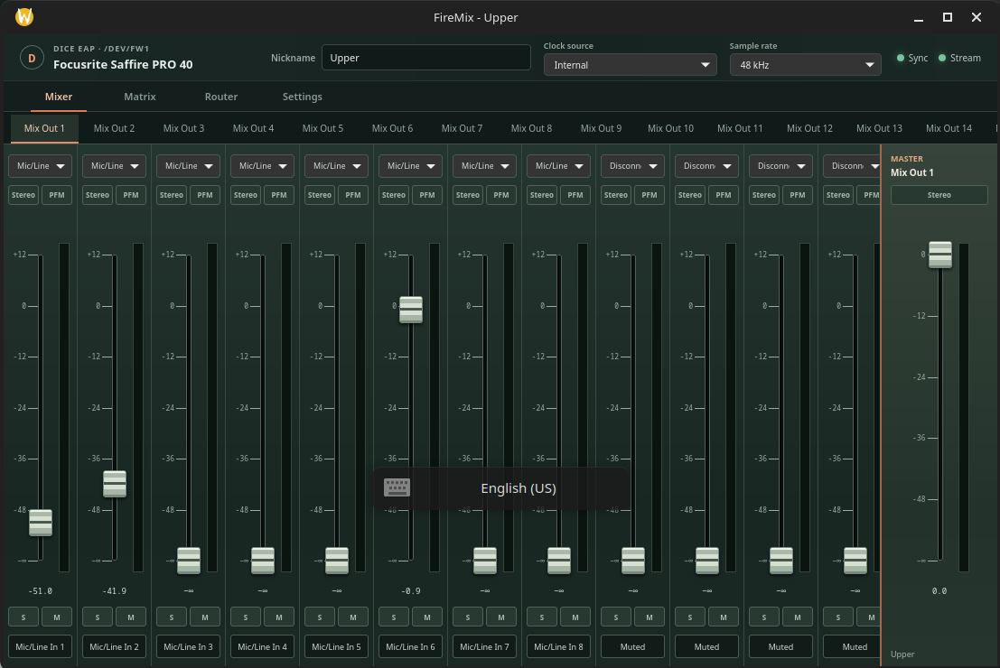

# FireMix (Modern Linux FireWire Audio Interface Mixer)
Mixer for firewire audio interfaces


## Ubuntu Build Dependencies

Install the system packages required to build the Tauri application:

```bash
sudo apt update
sudo apt install -y build-essential pkg-config curl wget file libssl-dev \
        libwebkit2gtk-4.1-dev libxdo-dev librsvg2-dev libayatana-appindicator3-dev
```

`libwebkit2gtk-4.1-dev` provides the WebKitGTK, JavaScriptCoreGTK, and libsoup
development dependencies required by Tauri on Linux.

Check the Rust backend with:

```bash
cargo check --manifest-path src-tauri/Cargo.toml
```

Run the FireWire scanner without opening the GUI:

```bash
cargo run --manifest-path src-tauri/Cargo.toml --bin scan
```

Inspect the live DICE EAP matrix dimensions and port labels without changing hardware:

```bash
cargo run --manifest-path src-tauri/Cargo.toml --bin scan -- --matrix
```

Launch the desktop application:

```bash
npm run tauri:dev
```

## DICE Configuration

For DICE EAP devices, FireMix stores the mixer, matrix, router, nickname, clock
source, and sample rate in `~/.config/firemix/<device_guid>.json` (or under
`$XDG_CONFIG_HOME/firemix` when configured). On startup or reconnection, a saved
configuration is applied to the matching device, overwriting its current settings.
Invalid or mismatched snapshots are rejected; a hardware error during restore can
leave settings partially applied and is reported by the application.
Sample rate and clock source are changed only when streaming is inactive. If a
saved value differs while streaming is active, stop streaming manually and restart
FireMix to retry the restore; PipeWire is not stopped automatically.

Run the Mixer math tests with Node.js 22.6 or newer:

```bash
npm run test:mixer
```

Build the desktop application for release:

```bash
npm run tauri:build
```